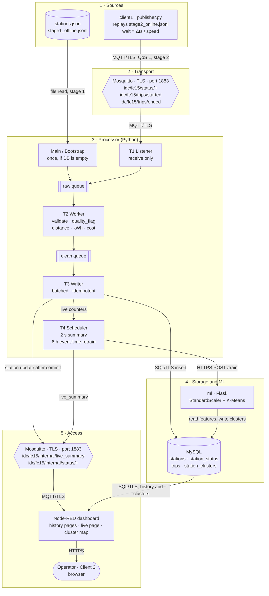

# Bike-Sharing Platform: Design Plan (v3)

Based on the project spec, the group's architecture document and execution plan, and the dataset description.

## 1. Services (Docker Compose, one private network)

| Service | Technology | Role | Host port |
|---|---|---|---|
| `client1` | Python 3.12, paho-mqtt, runs on the host | Replays `stage2_online.jsonl`: waits `Δts / --speed`, publishes each line unchanged to the topic of its type, QoS 1, auto-reconnect | none |
| `mosquitto` | eclipse-mosquitto | TLS listener, username + password, no anonymous access, ACL per client | 1883 (TLS) |
| `processor` | Python 3.12, paho-mqtt, mysql-connector | Loads, validates, computes, stores, notifies (section 3) | none |
| `db` | MySQL | Only the Processor writes; ML and Node-RED read | none |
| `ml` | Python 3.12, Flask, scikit-learn, pandas | `POST /train`, `GET /clusters` | none |
| `nodered` | Node-RED + dashboard, MySQL and worldmap nodes | Operator dashboard, HTTPS, editor login | 1880 (HTTPS) |

One CA (OpenSSL) signs the broker, Node-RED, MySQL and ML certificates. Passwords live in `.env`. Group 15: topic prefix `idc/fc15`. Broker: TLS on port 1883 (decided).

## 2. Topics

| Topic | Publisher | Subscriber |
|---|---|---|
| `idc/fc15/status/<station_id>` | client1 | processor |
| `idc/fc15/trips/started` | client1 | processor |
| `idc/fc15/trips/ended` | client1 | processor |
| `idc/fc15/internal/live_summary` | processor, every 2 s | nodered |
| `idc/fc15/internal/status/<station_id>` | processor, after each stored status | nodered |

The second internal topic gives the live map its per-station occupancy without polling MySQL.

## 3. Processor: one process, four threads, two queues

| Thread | Does | Never does |
|---|---|---|
| **Main / Bootstrap** | At start: if `stations` is empty, loads `stations.json` and feeds every line of `stage1_offline.jsonl` into the raw queue, then calls `POST /train`. Then starts T1. | Load stage 1 twice |
| **T1 Listener** | paho-mqtt network loop over TLS. Subscribes to `status/+` and `trips/+`. Puts the raw payload in the raw queue. | Parse, compute, touch MySQL |
| **T2 Worker** | Parses JSON, checks required fields by `type`, sets `quality_flag`. For `trip_ended`: Haversine distance, kWh, cost. Puts a ready row in the clean queue. | Touch MySQL |
| **T3 Writer** | Owns the only MySQL connection. Batched, idempotent inserts. Updates the in-memory live counters after each commit. Publishes `internal/status/<station_id>`. | Compute anything |
| **T4 Scheduler** | Every 2 s: publishes `live_summary`. Every 6 hours of event time: calls `POST /train`. | Block T1 to T3 |

Stage 1 and stage 2 go through the same T2 and T3, so both get the same cleaning rules.

## 4. Database (MySQL): the group's four tables, with four changes

| Table | Primary key | Change against the execution plan |
|---|---|---|
| `stations` | `station_id` | none |
| `station_status` | `id` | add `seq BIGINT UNIQUE` |
| `trips` | `trip_id` (= `ride_id`) | row is created at `trip_started` with `ended_at = NULL` and completed at `trip_ended` |
| `station_clusters` | `(station_id, trained_at)` | `trained_at` joins the key |

Why each change matters:

1. **`seq` unique.** MQTT QoS 1 and reconnects can deliver a message twice. `seq` is unique over both files, so a duplicate insert is ignored.
2. **Trip row created at start.** "Bikes in use" is `COUNT(*) WHERE ended_at IS NULL`. It survives a Processor restart and needs no fifth table. Stage 2 has 4 more `trip_ended` than `trip_started`, so some trips start in stage 1 and end in stage 2: this handles them with no special case. A `trip_ended` with no earlier start is inserted directly.
3. **`trained_at` in the key.** With `station_id` alone, each training overwrites the last one, and the dashboard cannot show how profiles evolve (required in stage 2).
4. **One flag per trip, fixed priority.** `MISSING_END` > `OUT_OF_AREA` > `OUTLIER_SHORT` > `OUTLIER_LONG` > `OK`. A trip still open after the `OUTLIER_LONG` threshold is closed as `NEVER_ENDED`, so it stops counting as a bike in use.

Rules that come from the data:

- Time is the event time `ts` (6 h retrain trigger, live KPIs, time empty/full). The wall clock is used only for the 2 s summary.
- `DATETIME` columns store the local time as received. Every timestamp is UTC−04:00 and there is no clock change in 13 to 22 March.
- `num_ebikes_available` is part of `num_bikes_available`: classic bikes = bikes − ebikes.
- `station_status` arrives only on change: time empty or full is the time until the next row of the same station (last state stays valid across gaps).
- Round trips (same start and end station) have distance 0, so 0 kWh. To state in the report.
- Rebalancing: bike count changes with no matching trip. Not stored as a trip.

## 5. ML service

`POST /train`: per-station features from MySQL (trips per dock per day, net flow, mean duration, % e-bike, % casual, occupancy rate, % time empty or full), StandardScaler, K-Means for k = 3, 4, 5, best silhouette wins, one new set of rows in `station_clusters`. Only trips with `quality_flag = 'OK'` are used.

## 6. Data flow (time grows to the right)

```mermaid
flowchart LR
    subgraph S1["1 · Sources"]
        direction TB
        OFF[("stations.json<br/>stage1_offline.jsonl")]
        PUB["client1 · publisher.py<br/>replays stage2_online.jsonl<br/>wait = Δts / speed"]
    end

    subgraph S2["2 · Transport"]
        BRK{{"Mosquitto · TLS<br/>idc/fc15/status/+<br/>idc/fc15/trips/started<br/>idc/fc15/trips/ended"}}
    end

    subgraph S3["3 · Processor · one Python process"]
        direction LR
        T0["Main / Bootstrap<br/>once, if DB is empty"]
        T1["T1 Listener<br/>receive only"]
        Q1[["raw queue"]]
        T2["T2 Worker<br/>validate · quality_flag<br/>distance · kWh · cost"]
        Q2[["clean queue"]]
        T3["T3 Writer<br/>batched · idempotent"]
        T4["T4 Scheduler<br/>2 s summary<br/>6 h event-time retrain"]
        T0 --> Q1
        T1 --> Q1
        Q1 --> T2
        T2 --> Q2
        Q2 --> T3
        T3 -. "live counters" .-> T4
    end

    subgraph S4["4 · Storage and ML"]
        direction TB
        DB[("MySQL<br/>stations · station_status<br/>trips · station_clusters")]
        ML["ml · Flask<br/>StandardScaler + K-Means"]
    end

    subgraph S5["5 · Access"]
        direction TB
        LIVE{{"Mosquitto · TLS<br/>idc/fc15/internal/live_summary<br/>idc/fc15/internal/status/+"}}
        NR["Node-RED dashboard<br/>history pages · live page · cluster map"]
        OP(["Operator · Client 2<br/>browser"])
    end

    OFF -- "file read, stage 1" --> T0
    PUB -- "MQTT/TLS, QoS 1, stage 2" --> BRK
    BRK -- "MQTT/TLS" --> T1
    T3 -- "SQL/TLS insert" --> DB
    T4 -- "HTTPS POST /train" --> ML
    ML -- "read features, write clusters" --> DB
    T3 -- "station update after commit" --> LIVE
    T4 -- "live_summary" --> LIVE
    LIVE -- "MQTT/TLS" --> NR
    DB -- "SQL/TLS, history and clusters" --> NR
    NR -- "HTTPS" --> OP
```

Both Mosquitto boxes are the same broker. It is drawn twice so that time keeps flowing to the right.

### Vertical version (time grows downwards)

## 7. Open points

1. The execution plan calls the ML service over plain `http://ml:5000`, and MySQL connections are not stated as encrypted. The spec says all communications must be secure, so this plan uses HTTPS and MySQL TLS with the same CA.
2. Outlier thresholds: fixed after the stage 1 exploratory analysis.
