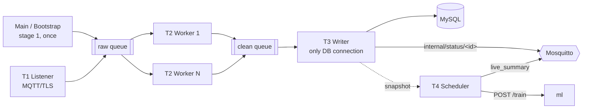

# Processor: implementation plan

Scope: `processor/` (Python 3.12), plus the schema changes it needs in `db/init/01_schema.sql`.
Follows `design-plan.md` sections 3 and 4.

## 1. Threads and queues

| Thread | Count | Job |
|---|---|---|
| Main / Bootstrap | 1 | Starts the threads, runs stage 1 once, shuts down in order |
| T1 Listener | 1 | paho-mqtt network thread (`loop_start`, so T3/T4 publishes never touch the TLS socket concurrently). Puts raw bytes in the raw queue. No parsing |
| T2 Worker | `WORKER_THREADS` (default 2) | Validates, flags, computes distance, kWh, cost |
| T3 Writer | 1 | Batched, idempotent writes in one transaction per batch. Publishes station updates. Builds the live snapshot |
| T4 Scheduler | 1 (+1 short-lived training thread) | Publishes `live_summary` every 2 s. Retrains every 6 h of event time |

Several workers are safe because every write is order-independent: a `trip_ended` processed before its `trip_started` gives the same row.

## 2. Start-up (stage 1)

1. Start T2 workers and T3 Writer.
2. Ask the DB: does `ingest_log` hold a completed row for `stage1_offline.jsonl` with the same SHA-256?
   - Yes: skip stage 1.
   - No: upsert the 83 stations, feed every line of stage 1 into the raw queue, wait until the Writer has **committed** everything, then write the `ingest_log` row.
3. A crash during stage 1 leaves no `ingest_log` row, so the next start feeds the file again. Idempotent writes make this safe.
4. Start T1 and T4. If stage 1 was just loaded, or `station_clusters` is empty, request a training (in the background, so stage 2 is not delayed).

## 3. Invalid data: keep it, flag it

Nothing is deleted. Two mechanisms, by how broken the message is:

| Case | Where it goes | Why |
|---|---|---|
| Message fits the table, but a value is suspicious | Same table, `quality_flag` column | Queries filter with `WHERE quality_flag = 'OK'`. One table per entity, no joins |
| Message cannot fit the table (not JSON, missing field, bad type, unknown station, topic spoofing) | `rejected_messages` (dead-letter table): raw bytes, reason, source, topic, best-effort `station_id` | The raw payload is kept for audit and replay |

`v_data_quality` (SQL view) groups all three sources per station and issue, with first and last occurrence. The dashboard reads it to show which stations send bad data.

### Flags (first match wins)

`station_status.quality_flag`:

| Flag | Rule |
|---|---|
| `NEGATIVE_COUNT` | any count below 0 |
| `EBIKES_GT_BIKES` | `num_ebikes_available > num_bikes_available` |
| `OVER_CAPACITY` | bikes + disabled bikes + docks + disabled docks > station capacity |
| `OK` | none of the above |

`trips.quality_flag` (set at `trip_ended`; `NULL` while open):

| Flag | Rule |
|---|---|
| `MISSING_END` | no `end_station_id` |
| `MISSING_START` | no `start_station_id` |
| `INVALID_DURATION` | `duration_s <= 0`, `ended_at < started_at`, or `duration_s` differs from `ended_at - started_at` by more than 60 s |
| `OUT_OF_AREA` | start or end station outside the 83 |
| `OUTLIER_SHORT` | `duration_s < 60` (Citi Bike's own false-start rule) |
| `OUTLIER_LONG` | `duration_s > 3 h` |
| `OK` | none of the above |
| `NEVER_ENDED` | set by the Writer on trips still open 3 h after start (event time). A later `trip_ended` overwrites it |

`rejected_messages.reason`: `OVERSIZE` (> 64 KiB), `INVALID_JSON`, `NOT_AN_OBJECT`, `UNKNOWN_TYPE`, `MISSING_FIELD`, `INVALID_VALUE`, `UNKNOWN_STATION`, `TOPIC_MISMATCH`, `DB_REJECTED`.

## 4. Computations

- Distance: Haversine between the station coordinates from `stations.json` when both stations are known, else the message coordinates. Round trips give 0.
- Energy: `15 Wh/km × distance / 1000` for `electric_bike`, 0 for `classic_bike`.
- Cost: minutes rounded up. Member: `0.20 × max(0, min − 45)`. Casual: `4.50 + 0.30 × max(0, min − 30)`. E-bike surcharge on every minute: `0.25` member, `0.35` casual.
- Timestamps: converted to UTC−04:00 and stored without offset.

## 5. Schema changes

| Table | Change |
|---|---|
| `station_status` | `quality_flag`, `source`, index `(station_id, seq)` |
| `trips` | flags `MISSING_START`, `INVALID_DURATION`; `source` (who completed the row) |
| `rejected_messages` | new (dead-letter) |
| `ingest_log` | new (stage 1 done marker) |
| `v_data_quality` | new view |

The schema runs only on a new volume: `docker compose down -v`, then `up`.

## 6. Outputs to the dashboard

- `idc/fc15/internal/status/<station_id>`, QoS 1, retained: latest state of the station with name, coordinates, capacity and `quality_flag`. All stations are republished on each (re)connect.
- `idc/fc15/internal/live_summary`, every 2 s: the fields Node-RED already uses (`active_trips`, `total_bikes_avail`, `total_ebikes_avail`, `stage2_trips`, `stage2_energy_kwh`, `stage2_avg_duration_min`, `updated_at`), plus `last_event_ts` and data-quality counters.

## 7. Security

- TLS with CA verification on MQTT, MySQL and HTTPS to ML (already in place).
- Parameterised SQL only. Payload size limit before parsing. Topic and payload must agree (`TOPIC_MISMATCH`).
- Payloads are never logged at INFO level; logs show reason and seq only.

## 8. ML service (same track)

`POST /train`: features per station (section 5 of `design-plan.md`), only `OK` trips, status rows forward-filled until the next update. StandardScaler + K-Means for k = 3, 4, 5, best silhouette. Clusters are renumbered by turnover (0 = least used) so a number keeps its meaning across trainings. `trained_at` = newest event time in the data.

## 9. Tests

- `processor/tests/`: 57 unit tests for calc, validation and flags (pytest, no services). One test runs all 73 580 dataset messages through validation: none is rejected.
- `scripts/eda_offline.py`: thresholds, flag counts, update gaps, rebalancing estimate.
- Integration (MySQL 8.4 + Mosquitto over TLS in Docker, processor and ML on the host):
  - stage 1 loads in about 5 s; a restart does not load it again;
  - stage 2 at `--speed 3600`: all 19 856 messages stored, 11 trainings (one every 6 h of event time), no broker disconnects;
  - injected bad messages land in `rejected_messages`, duplicates are stored once;
  - a MySQL restart during a replay loses nothing (the batch is retried).
